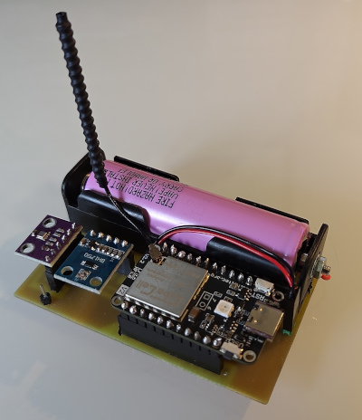

> [!NOTE]
> Work in progress, check back regularly for updates. Current [prototype](doc/prototype.md).

# Beetle E1 - LoRa environment sensor



* LoRaWAN implementation
* Measures:
	* Temperature
	* Humidity
	* Pressure
	* Light
* Rechargable battery (via USB)
* Weather proof case

## Hardware components
* [CubeCell HTCC-AB01_V2](https://docs.heltec.cn/en/node/asr650x/htcc_ab01/) with antenna
* BME280 (temperature, humidity, pressure sensor)
* BH1750 (light sensor)
* Lithium-ion battery 3.7V (18650)
* Battery holder
* [Circuit board](board/README.md)
* Case

## Software setup
1. Create local key file:
	```shell
	cp keys.h.default keys.h
	```
	Updating this file is optional, but recommended, see *Keys* section below.
2. Setup *Arduino IDE*: https://docs.heltec.org/en/node/asr650x/asr650x_general_docs/quick_start/index.html
	1. Go to *File* -> *Preferences* -> *Additional boards manager URLs* and add `https://github.com/HelTecAutomation/CubeCell-Arduino/releases/download/V1.7.1/package_CubeCell_index.json`
	2. In *Board manager*, install *CubeCell Development Framework*
3. Open this project and select board `CubeCell-Board (HTCC-AB01-V2)`
4. Install the following libraries via the Arduino *Library Manager*:
	* `Adafruit BME280 Library` (pulls in `Adafruit Unified Sensor`)
	* `BH1750` by Christopher Laws
5. In the *Tools* menu, configure:
	* `LORAWAN_ADR`        : `ON`
	* `LORAWAN_CLASS`      : `CLASS_A`
	* `LORAWAN_DEVEUI`     : `CUSTOM`
	* `LORAWAN_Net_Reservation`: `ON` (keep network state across deep sleep)
	* `LORAWAN_NETMODE`    : `OTAA`
	* `LORAWAN_REGION`     : `REGION_EU868` (or your region)
	* `LORAWAN_UPLINKMODE` : `UNCONFIRMED`
6. Compile and flash this to your device.
7. Take note of the `ChipID`, `DevEUI`, `AppEUI` and `AppKey` in the serial output and register the device in TTN.

### Keys
Credentials are resolved per field in `keys.h`:

| Field  | Per-device `keyMap` entry | Fallback                   |
|--------|---------------------------|----------------------------|
| DevEUI | `devEui`                  | generated from the chip ID |
| AppEUI | `appEui`                  | `DEFAULT_APP_EUI`          |
| AppKey | `appKey`                  | `DEFAULT_APP_KEY`          |

Omitted or all-zero fields in a `keyMap` entry fall back to the right column.
Typical setups:
* **Shared key:** set `DEFAULT_APP_KEY` and leave `keyMap` empty.
* **Unique key per device (recommended):** add a `keyMap` entry per `ChipID` with only `appKey` set.
* **Fully custom:** set `devEui`, `appEui` and `appKey` in the entry.

## Uplink payload

Sent on `port 2`, 11 bytes, big-endian:

| Bytes | Field        | Encoding              | Example          |
|-------|--------------|-----------------------|------------------|
| 0..1  | Temperature  | `int16`,  value × 100 | `2345`  → 23.45 °C |
| 2..3  | Humidity     | `uint16`, value × 100 | `5012`  → 50.12 % |
| 4..5  | Pressure     | `uint16`, value × 10  | `10132` → 1013.2 hPa |
| 6..9  | Light        | `uint32`, value × 100 | `12345` → 123.45 lux |
| 10    | BatteryLevel | `uint8`, value x 1    | `0` = external power, `1..254`=0-100%, `255` = N/A  |

### Decoding
If using with TTN, use content from `ttn-uplink-formatter.js` for the
*Custom Javscript formatter*.
