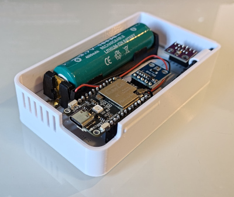
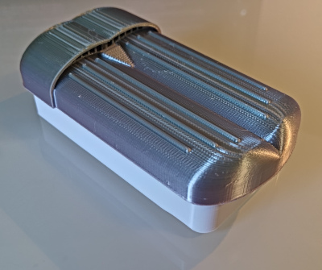

# Beetle E1 - LoRa environment sensor

* LoRaWAN implementation
* Measures:
	* Temperature
	* Humidity
	* Pressure
	* Light
* Rechargable battery (via USB)
	* Up to 3 years of battery life ([details](doc/battery.md))
* Weather proof case

## Hardware components
* [CubeCell HTCC-AB01_V2](https://docs.heltec.cn/en/node/asr650x/htcc_ab01/) with antenna
* BME280 (temperature, humidity, pressure sensor)
* BH1750 (light sensor)
* Lithium-ion battery 3.7V (18650)
* Battery holder
* [Circuit board](board/README.md)
* [Case](case/README.md)

See [cost](doc/cost.md) for estimated pricing.

## Software setup
See [software](doc/software.md) with instructions how to flash the *CubeCell*.

## Receive and send data
* [Uplinks](doc/uplink.md)
* [Downlinks](doc/downlink.md)
