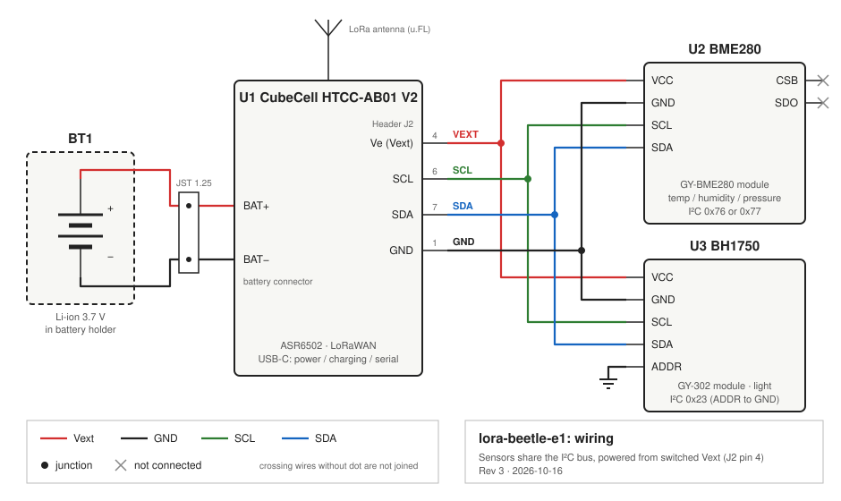
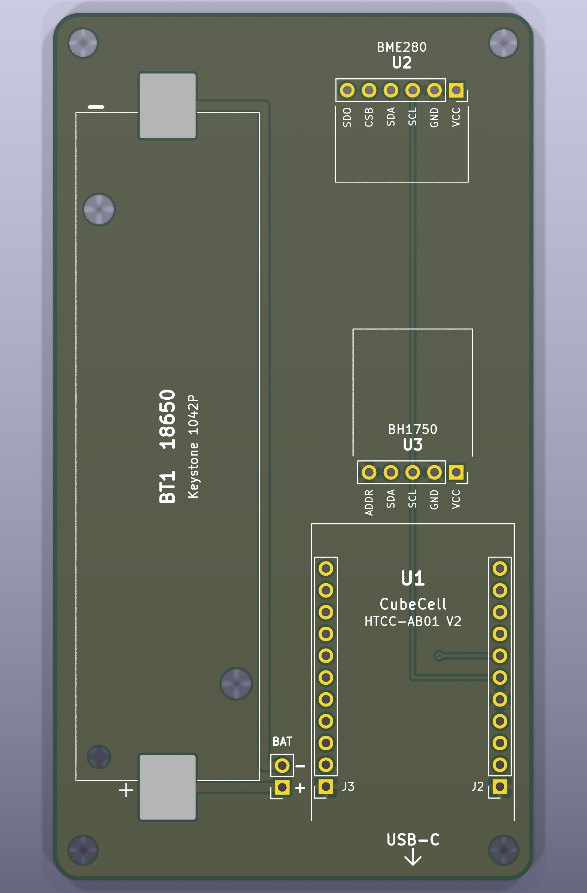
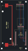
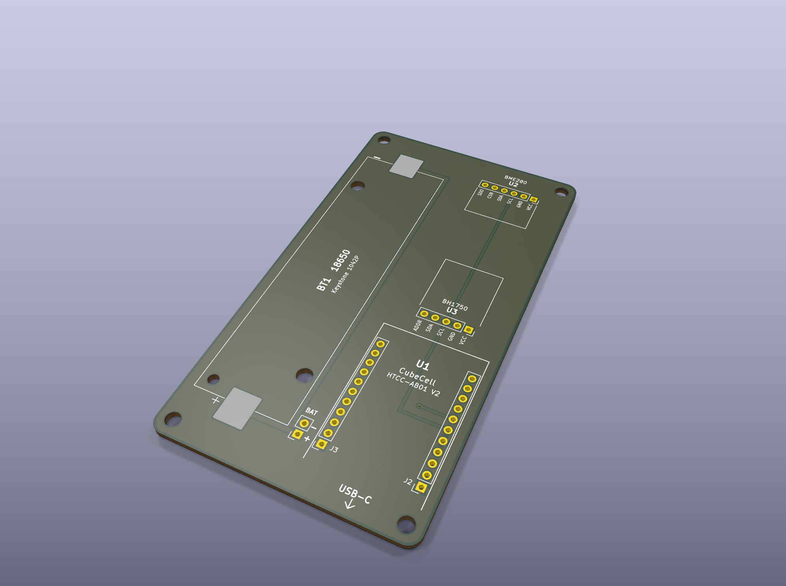

# Circuit board

## Wiring



Both sensors share the CubeCell I²C bus and are powered from the switched
Vext output on header J2 (pin 4, labelled `Ve`).

| From (CubeCell J2) | BME280 (GY-BME280) | BH1750 (GY-302) | Wire colour |
|--------------------|--------------------|-----------------|-------------|
| Pin 4 `Ve` (Vext)  | `VCC`              | `VCC`           | red         |
| Pin 1 `GND`        | `GND`              | `GND`           | black       |
| Pin 6 `SCL`        | `SCL`              | `SCL`           | green       |
| Pin 7 `SDA`        | `SDA`              | `SDA`           | blue        |
| Pin 1 `GND`        | –                  | `ADDR`          | black       |
| –                  | `CSB`, `SDO`: not connected | –      | –           |

Notes:
* Vext is switched by the firmware (GPIO6, `Vext` LOW = on). It is turned off
  between uplinks so the sensors draw no current in deep sleep.
* The BH1750 `ADDR` pin is tied to GND, which gives I²C address `0x23`. The
  GY-302 module has its own pull-down, but a hard GND does not depend on it.
* The BME280 `CSB`/`SDO` pins are left open. The module's pull-ups select I²C
  mode; the firmware tries both `0x76` and `0x77`.
* The 18650 holder is wired to the `BAT` header on the carrier board. A short
  JST 1.25 lead goes from there to the CubeCell's battery socket on its
  underside. The battery is charged through the CubeCell's USB-C port.

## Carrier board



A 56 × 101 mm two-layer board. The 18650 holder runs along the left edge.
The CubeCell, BH1750 and BME280 sit in a column beside it, with the CubeCell's
USB-C port at the board edge. All parts go on the top side, and every module
plugs into female pin headers.

| Ref  | Part                                   | Footprint                 |
|------|----------------------------------------|---------------------------|
| BT1  | Keystone 1042P 18650 holder (SMD)      | SMD pads + locating holes |
| J1   | Battery header (`+` / `−`)             | 1×2 female, 2.54 mm       |
| J2   | CubeCell header J2                     | 1×11 female, 2.54 mm      |
| J3   | CubeCell header J3 (mechanical, GND)   | 1×11 female, 2.54 mm      |
| J4   | BME280 module (GY-BME280)              | 1×6 female, 2.54 mm       |
| J5   | BH1750 module (GY-302)                 | 1×5 female, 2.54 mm       |
| H1–4 | Mounting holes                         | M3 (3.2 mm)               |

Routing (red = top layer, blue = bottom layer, GND pours hidden):



* SCL is on the top layer. Vext is on the bottom layer. SDA starts on the top
  layer and drops through a via to the bottom. The top render above only shows
  SCL. The other traces are underneath.
* GND has no traces. Every GND pad (CubeCell J2-1, J2-5 and J3-1, each
  sensor's `GND`, and the BH1750 `ADDR`) connects to the copper pour on both
  layers.
* The battery nets only connect the holder to J1. They are not joined to GND on
  the board, because the CubeCell does that through the JST lead.

Assembly notes:
* The BH1750 goes in sensor side up, with its body pointing towards the top of
  the board. The BME280 goes in sensor side down, with its body pointing
  towards the bottom of the board. The silkscreen outlines show where each
  body goes, and there is about 17 mm between them. Match the
  `VCC`/`GND`/… labels on the board to the ones on the module.
* The M3 hole in the bottom-right corner is under the CubeCell. Fit that screw
  before plugging the CubeCell in.
* **Check the battery polarity before connecting.** The `+` end of the
  holder follows the KiCad footprint (pad 1, the end with the small polarising
  peg). Confirm it against the marking on your holder, and check `+`/`−` at
  J1 with a multimeter before plugging in the lead to the CubeCell.

### Ordering from PCBWay

Upload [`pcb/lora-beetle-e1-gerbers.zip`](pcb/lora-beetle-e1-gerbers.zip).
The defaults work: 2 layers, 1.6 mm FR-4, 1 oz copper, HASL, no stencil.
Minimum track and gap is 0.25 mm, and the smallest hole is the 0.4 mm via.

### Editing

The board is generated by [`pcb/build_pcb.py`](pcb/build_pcb.py). Change the
script, not the `.kicad_pcb` file, then run:

```shell
board/pcb/build.sh
```

This needs Docker; it runs KiCad 9 from the `kicad/kicad` image. It rebuilds
`lora-beetle-e1.kicad_pcb`, runs DRC, and exports the Gerbers, drill file, zip
and the renders in `images/`. You can open `pcb/lora-beetle-e1.kicad_pro` in
KiCad 9 to inspect the board.


