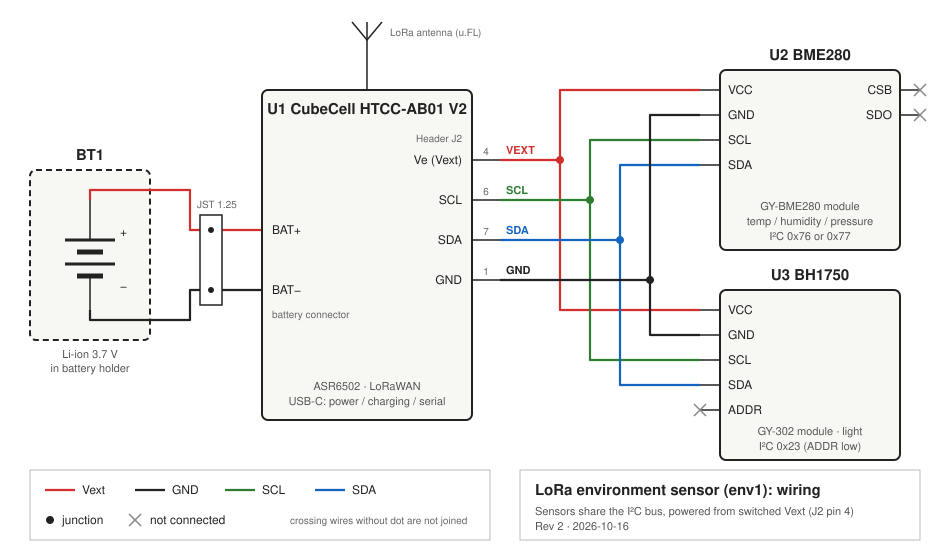

# Circuit board

## Wiring

Both sensors share the CubeCell I²C bus and are powered from the switched
Vext output on header J2 (pin 4, labelled `Ve`).

| From (CubeCell J2) | BME280 (GY-BME280) | BH1750 (GY-302) | Wire colour |
|--------------------|--------------------|-----------------|-------------|
| Pin 4 `Ve` (Vext)  | `VCC`              | `VCC`           | red         |
| Pin 1 `GND`        | `GND`              | `GND`           | black       |
| Pin 6 `SCL`        | `SCL`              | `SCL`           | green       |
| Pin 7 `SDA`        | `SDA`              | `SDA`           | blue        |
| –                  | `CSB`, `SDO`: not connected | `ADDR`: not connected | – |

Notes:
* Vext is switched by the firmware (GPIO6, `Vext` LOW = on). It is turned off
  between uplinks so the sensors draw no current in deep sleep.
* The BH1750 `ADDR` pin is left open, which gives I²C address `0x23`.
* The BME280 `CSB`/`SDO` pins are left open. The module's pull-ups select I²C
  mode; the firmware tries both `0x76` and `0x77`.
* The 3.7 V Li-ion battery in the battery holder plugs into the CubeCell's
  battery connector. It is charged through the CubeCell's USB-C port.
