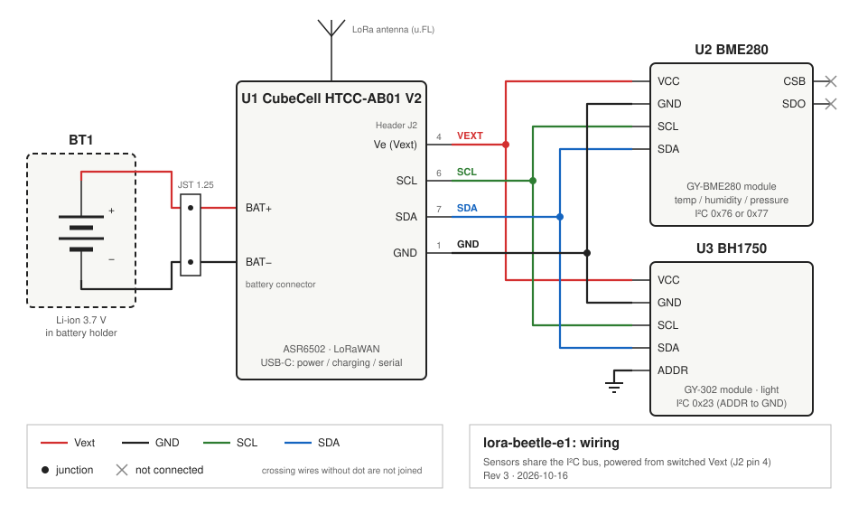
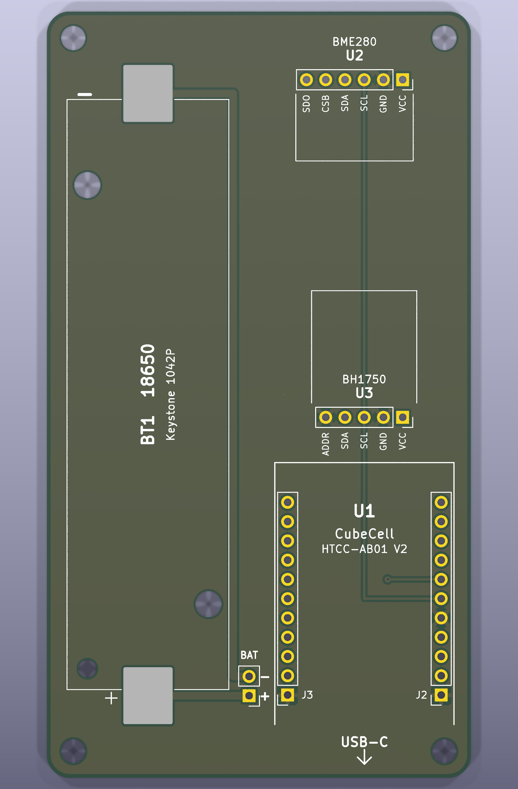
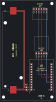
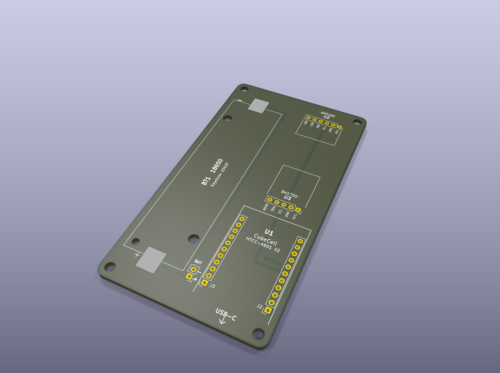

# Circuit board

## Wiring



Both sensors share the CubeCell I²C bus and are powered from the switched
Vext output on header J2 (pin 4, labelled `Ve`).

| From (CubeCell J2) | BME280 (GY-BME280) | BH1750 (GY-302) | Wire colour |
|--------------------|--------------------|-----------------|-------------|
| Pin 4 `Ve` (Vext)  | `VCC`              | `VCC`           | red         |
| Pin 1 `GND`        | `GND`              | `GND`           | black       |
| Pin 6 `SCL`        | `SCL`              | `SCL`           | green       |
| Pin 7 `SDA`        | `SDA`              | `SDA`           | blue        |
| Pin 1 `GND`        | –                  | `ADDR`          | black       |
| –                  | `CSB`, `SDO`: not connected | –      | –           |

Notes:
* Vext is switched by the firmware (GPIO6, `Vext` LOW = on). It is turned off
  between uplinks so the sensors draw no current in deep sleep.
* The BH1750 `ADDR` pin is tied to GND, which gives I²C address `0x23`. The
  GY-302 module has its own pull-down, but a hard GND does not depend on it.
* The BME280 `CSB`/`SDO` pins are left open. The module's pull-ups select I²C
  mode; the firmware tries both `0x76` and `0x77`.
* The 18650 holder is wired to the `BAT` header on the carrier board. A short
  JST 1.25 lead goes from there to the CubeCell's battery socket on its
  underside. The battery is charged through the CubeCell's USB-C port.

## Carrier board
*See here for initial [prototype](prototype.md).*



A 56 × 101 mm two-layer board. The 18650 holder runs along the left edge.
The CubeCell, BH1750 and BME280 sit in a column beside it, with the CubeCell's
USB-C port at the board edge. All parts go on the top side, and every module
plugs into female pin headers.

| Ref  | Part                                   | Footprint                 |
|------|----------------------------------------|---------------------------|
| BT1  | Keystone 1042P 18650 holder (SMD)      | SMD pads + locating holes |
| J1   | Battery header (`+` / `−`)             | 1×2 male, 2.54 mm         |
| J2   | CubeCell header J2                     | 1×11 female, 2.54 mm      |
| J3   | CubeCell header J3 (mechanical, GND)   | 1×11 female, 2.54 mm      |
| J4   | BME280 module (GY-BME280)              | 1×6 female, 2.54 mm       |
| J5   | BH1750 module (GY-302)                 | 1×5 female, 2.54 mm       |
| H1–4 | Mounting holes                         | M3 (3.2 mm)               |

Routing (red = top layer, blue = bottom layer, GND pours hidden):



* SCL is on the top layer. Vext is on the bottom layer. SDA starts on the top
  layer and drops through a via to the bottom. The top render above only shows
  SCL. The other traces are underneath.
* GND has no traces. Every GND pad (CubeCell J2-1, J2-5 and J3-1, each
  sensor's `GND`, and the BH1750 `ADDR`) connects to the copper pour on both
  layers.
* The battery nets only connect the holder to J1. They are not joined to GND on
  the board, because the CubeCell does that through the JST lead.

See [Assembly](#assembly) for how to put it together.

### Ordering from PCBWay

Upload [`pcb/lora-beetle-e1-gerbers.zip`](pcb/lora-beetle-e1-gerbers.zip).
The defaults work: 2 layers, 1.6 mm FR-4, 1 oz copper, HASL, no stencil.
Minimum track and gap is 0.25 mm, and the smallest hole is the 0.4 mm via.

### Editing

The board is generated by [`pcb/build_pcb.py`](pcb/build_pcb.py). Change the
script, not the `.kicad_pcb` file, then run:

```shell
board/pcb/build.sh
```

This needs Docker; it runs KiCad 9 from the `kicad/kicad` image. It rebuilds
`lora-beetle-e1.kicad_pcb`, runs DRC, and exports the Gerbers, drill file, zip
and the renders in `images/`. You can open `pcb/lora-beetle-e1.kicad_pro` in
KiCad 9 to inspect the board.



## Assembly

Besides the board and the parts in the table above, you need:
* The CubeCell, BME280 and BH1750 modules, with the male pin headers that come
  with them.
* The JST 1.25 battery lead (that comes with the CubeCell), a 1×2 female pin
  header and some heat shrink.
* An 18650 battery cell.

Use standard 8.5 mm tall female headers. The case is designed for that height,
so the USB-C port lines up with the opening in the bottom wall.

### Soldering

1. **Battery holder (BT1).** Set the holder on its outline with the pegs in
   the locating holes. The small polarising peg only lets it sit one way.
   Solder the two large pads. They take a lot of heat, so use a large tip.
2. **Battery header (J1).** Push the short pins of the 1×2 male header into
   the board from the top, and solder them from below.
3. **Modules and their headers (J2–J5).** Solder each module and its female
   header as a stack, so the pins end up straight and square. Push the female
   header into the board from the top, push the male header into it with the
   long pins down, and put the module on top. Solder the pins on the module,
   then turn the board over and solder the female header from below. Get the
   module the right way round first, as it is hard to undo:
   * **CubeCell (J2, J3):** USB-C side up, with the port at the board edge.
   * **BH1750 (J5):** sensor side up, with its body pointing towards the top
     of the board.
   * **BME280 (J4):** sensor side down, with its body pointing towards the
     bottom of the board.

   The silkscreen outlines show where each body goes, and there is about
   17 mm between the two sensors. The `VCC`/`GND`/… labels on the board must
   match the ones on the module. If a module came with its header already
   soldered, just solder the female header with the module plugged in.
4. **Battery lead.** Solder the bare ends to the pins of the 1×2 female
   header, cover each joint with heat shrink and mark the `+` side. The wire that goes to `+` on the CubeCell's socket (normally red) must
   end up on `+` at J1.

### Putting it together

1. **Check the board.** With nothing plugged in, check with a multimeter that
   there is no connection between `VCC` and `GND`, between `SCL` and `SDA`,
   or between `+` and `−` on J1. `ADDR` and `GND` on J5 are meant to be
   connected.
2. **Check the battery polarity.** Put the cell in the holder, as marked on
   the holder. The `+` end of the holder follows the KiCad footprint (pad 1,
   the end with the small polarising peg), at the bottom next to `BAT`.
   Measure J1: `+` should read 3.0–4.2 V against `−`. If it reads negative,
   stop and find out why before going on.
3. **Antenna.** Connect the LoRa antenna to the CubeCell. Don't power the
   CubeCell without it, because transmitting without an antenna can damage
   the radio.
4. **Sensors.** Plug the BH1750 into J5 and the BME280 into J4, the same way
   round as they were soldered.
5. **CubeCell.** Plug the JST end of the lead into the battery socket on the
   underside of the CubeCell. Then press the CubeCell into J2 and J3, with
   USB-C at the board edge, and lead the wire out from under it to J1.
6. **Power.** Push the lead's female header onto J1, `+` to `+`. The CubeCell
   starts up. Flash the firmware as described in
   [Software setup](../README.md#software-setup), and charge the cell through
   the USB-C port.
7. **Case.** Fit the board in the case, see [Case assembly](../case/README.md#assembly).
