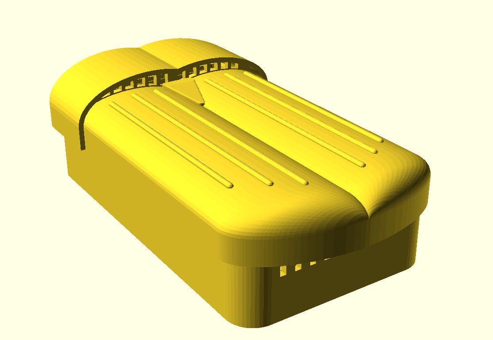
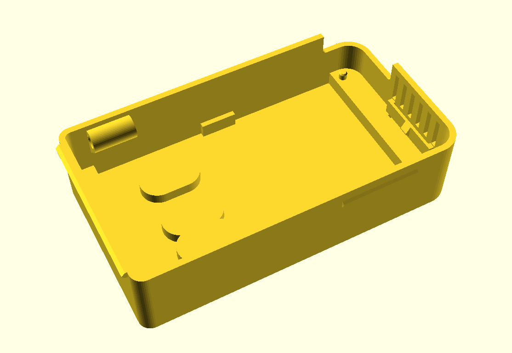
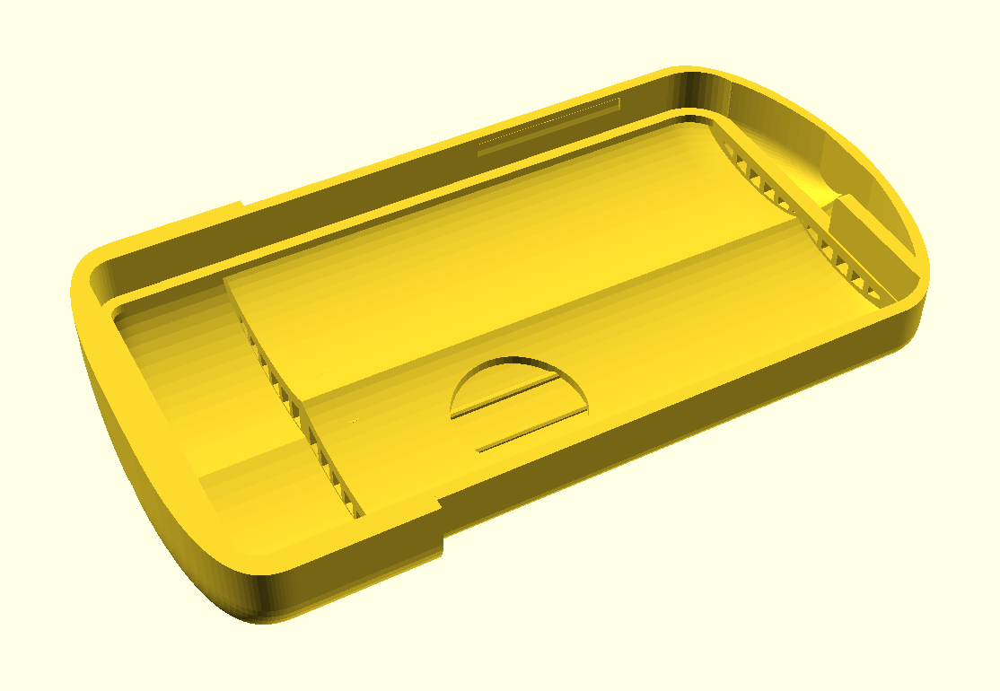
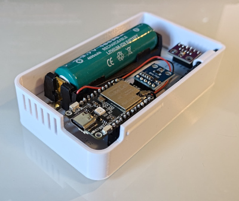
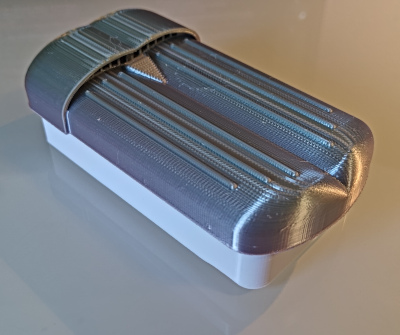

# Case

<p>



</p>

A beetle themed wall case (based on this [sketch](images/sketch-case.svg)). It has two
printed parts:

* **Base**: hangs on the wall and holds the carrier board.
* **Lid**: thorax and wing covers. It hooks onto the top of the base and
  snaps on at the sides.

Air enters under the wing tips at the bottom, rises past the sensors and
leaves through vents under the thorax lip. All openings face down, so rain
from above can't get in. The light sensor (BH1750) sits under a thin spot in
the right wing cover, letting relatively much light in.

| File                                           | Contents                                            |
|------------------------------------------------|-----------------------------------------------------|
| [`beetle-base.scad`](beetle-base.scad)         | Base, in print orientation                          |
| [`beetle-lid.scad`](beetle-lid.scad)           | Lid, in print orientation                           |
| [`beetle-assembly.scad`](beetle-assembly.scad) | Both parts and a board mock-up, as mounted          |
| [`beetle-common.scad`](beetle-common.scad)     | All dimensions, shared by the files above           |

The assembly file has customizer settings to hide parts, lift the lid
(`explode`), swing it open on its hook (`open_angle`) and cut the model open
(`section`).

Export the STL files with OpenSCAD (*Render*, then *Export as STL*) or run:
```shell
openscad -o beetle-base.stl beetle-base.scad
openscad -o beetle-lid.stl beetle-lid.scad
```

To re-render the above preview images, run `render-images.sh`.

## Printing
* **Base**: back on the bed, no support needed.
* **Lid**: open side down, as the file shows it. Enable supports
  *on build plate only* for the inside of the domes. The vent holes do not need support.
* **Material**: PLA works fine. If mounted outdoors, PLA might soften in the sun and go brittle over time, consider using PETG or ASA instead.

## Assembly
1. Slide the top end of the board (the BME280 end) into the slot at the top,
   under the antenna tunnel in the base. Then press the bottom edge down until it
   snaps in under the clip on the bottom wall. The board rests on a bar at each
   end, and the two pins go into the bottom mounting holes.
2. Push the LoRa antenna up into the tunnel on the right-hand wall, from below.
3. Hook the top edge of the lid behind the lip on top of the base. Then swing
   the lid down until the snaps on both sides click.
4. Hang the base on one or two screws, with a shank of up to about 4 mm and a
   head of up to about 8 mm:
   * **Two screws** go in the outer keyhole slots. Drill the holes 28 mm apart,
     level with each other.
   * **One screw** goes in the middle slot. It is 3 mm left of centre, in line with
     the centre of gravity, so the case hangs straight.

   Leave the heads about 2.5 mm out from the wall. Put the base over the heads
   and slide it down so it hangs on the keyhole slots.

<p>


</p>

To open the case, push gently on the sides where the clips are and pull the bottom
part of the lid up.

Once the lid is off, the USB-C port is available for charging (or debugging).
Also, the buttons are accessible:
* **Reset** button (right side) resets the device and performs a new join.
* **User** button (left side) triggers an uplink and restarts the interval.
