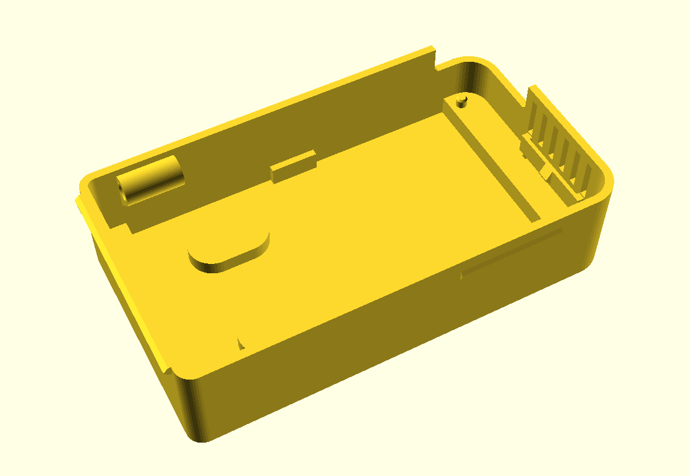
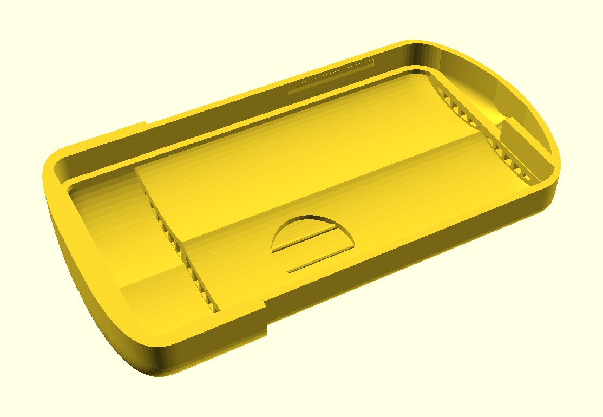

# Case





A beetle themed wall case (based on this [sketch](images/case-sketch.svg)). It has two
printed parts:

* **Base**: hangs on the wall and holds the carrier board.
* **Lid**: thorax and wing covers. It hooks onto the top of the base and
  snaps on at the sides.

Air enters under the wing tips at the bottom, rises past the sensors and
leaves through vents under the thorax lip. All openings face down, so rain
from above can't get in. The light sensor (BH1750) sits under a thin spot in
the right wing cover, hopefully letting enough light through.

| File                                           | Contents                                            |
|------------------------------------------------|-----------------------------------------------------|
| [`beetle-base.scad`](beetle-base.scad)         | Base, in print orientation                          |
| [`beetle-lid.scad`](beetle-lid.scad)           | Lid, in print orientation                           |
| [`beetle-assembly.scad`](beetle-assembly.scad) | Both parts and a board mock-up, as mounted          |
| [`beetle-common.scad`](beetle-common.scad)     | All dimensions, shared by the files above           |

The assembly file has customizer settings to hide parts, lift the lid
(`explode`), swing it open on its hook (`open_angle`) and cut the model open
(`section`).

Export the STL files with OpenSCAD (*Render*, then *Export as STL*) or run:
```shell
openscad -o beetle-base.stl case/beetle-base.scad
openscad -o beetle-lid.stl case/beetle-lid.scad
```

To re-render the images, run `render-images.sh`.

## Printing
* Use PETG or ASA, not PLA. PLA softens in the sun and goes brittle outdoors.
  Preferable print the lid in a light color, to allow more light in for the light sensor.
* **Base**: back on the bed, no supports.
* **Lid**: open side down, as the file shows it. Enable supports
  *on build plate only* for the inside of the domes.

## Assembly
1. Slide the top end of the board (the BME280 end) into the slot at the top,
   under the antenna clip in the base. Then press the bottom edge down until the hook
   clicks. The board rests on a bar at each end, and the two pins go into the
   bottom mounting holes.
2. Press the LoRa antenna into the clip on the right-hand wall.
3. Hook the top edge of the lid behind the lip on top of the base. Then swing
   the lid down until the snaps on both sides click.
4. Drill two holes 28 mm apart in the wall, level with each other, and fit screws with a
   shank up to 4.4 mm and a head up to 8.5 mm. Leave the heads about 2.5 mm out from the wall. Put the base over
   the heads and slide it down so it hangs on the keyhole slots.

To open the case, pull the wing tips away from the wall. Take the lid off to
charge the battery: a tab on the lid closes the USB-C opening in the bottom
wall. To take out the board, push the hook at the bottom edge towards the
bottom wall, lift that end of the board and pull it out of the slot.
