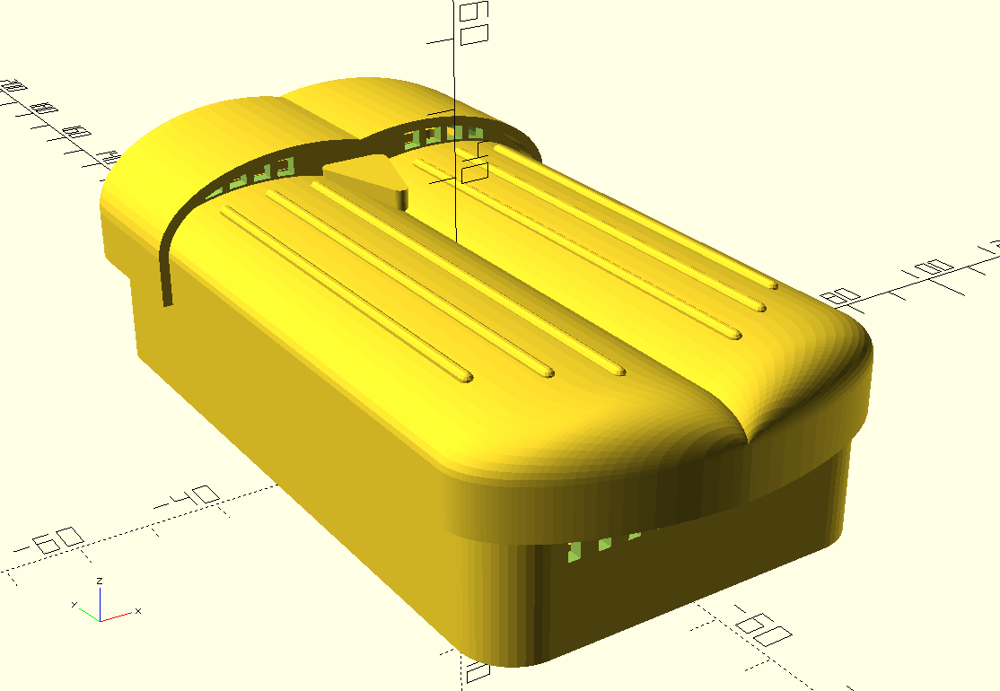

# Case



A beetle themed wall case, based on the [sketch](case-sketch.svg). It has two
printed parts:

* **Base**: hangs on the wall and holds the carrier board.
* **Lid**: thorax and wing covers. It hooks onto the top of the base and
  snaps on at the sides.

Air enters under the wing tips at the bottom, rises past the sensors and
leaves through vents under the thorax lip. All openings face down, so rain
from above can't get in. The light sensor (BH1750) sits under a thin spot in the right wing
cover, hopefully letting enough light through.

| File                                           | Contents                                            |
|------------------------------------------------|-----------------------------------------------------|
| [`beetle-base.scad`](beetle-base.scad)         | Base, in print orientation                          |
| [`beetle-lid.scad`](beetle-lid.scad)           | Lid, in print orientation                           |
| [`beetle-assembly.scad`](beetle-assembly.scad) | Both parts and a board mock-up, as mounted          |
| [`beetle-common.scad`](beetle-common.scad)     | All dimensions, shared by the files above           |

The assembly file has customizer settings to hide parts, lift the lid
(`explode`), swing it open on its hook (`open_angle`) and cut the model open
(`section`).

Export the STL files with OpenSCAD (*Render*, then *Export as STL*) or:
```shell
openscad -o beetle-base.stl case/beetle-base.scad
openscad -o beetle-lid.stl case/beetle-lid.scad
```

Render `.scad` file:
```shell
openscad -o case/images/beetle-assembly.png --imgsize=800,1000 \
	--colorscheme=Tomorrow --camera=0,0,0,-25,35,0,0 --viewall --autocenter \
	case/beetle-assembly.scad
```

## Printing
* Use PETG or ASA, not PLA. PLA softens in the sun and goes brittle outdoors.
  Print the lid in **white**. Daylight reaches the light sensor through the
  0.8 mm window, and a white lid also keeps the case cool.
* **Base**: back on the bed, no supports.
* **Lid**: open side down, as the file shows it. Enable supports
  *on build plate only* for the inside of the domes. Remove them through the
  open side. A fine layer height (0.12-0.16 mm) gives smoother domes.

## Assembly
1. Drill two holes 28 mm apart, level with each other, and fit screws with a
   shank up to 4.4 mm and a head up to 8.5 mm (for example 4 mm pan head
   screws). Leave the heads about 2.5 mm out from the wall. Put the base over
   the heads and slide it down so it hangs on the keyhole slots.
2. Slide the top edge of the board (the BME280 end) under the two lips at the
   top of the base. Then press the bottom edge down until the hook clicks.
   The two pins go into the bottom mounting holes.
3. Press the LoRa antenna into the two clips on the right-hand wall.
4. Hook the top edge of the lid behind the lip on top of the base. Then swing
   the lid down until the snaps on both sides click.

To open the case, pull the wing tips away from the wall. Take the lid off to
charge the battery: a tab on the lid closes the USB-C opening in the bottom
wall. To take out the board, push the hook at the bottom edge towards the
bottom wall and lift that end of the board.

## Check before printing
These dimensions come from datasheets and standard parts. Measure your own
parts and adjust them in [`beetle-common.scad`](beetle-common.scad) if they
differ:
* `header_stack` (11 mm): from the top of the carrier board to the underside
  of the CubeCell. That is an 8.5 mm female socket plus the 2.5 mm plastic of
  the male pins. It sets the height of the USB-C opening.
* `ant_d` (5.4 mm): the bore of the antenna clips, for a spring antenna of
  about 5 mm.
* `lid_clr` (0.3 mm) and `snap_h`: the fit between the lid and base. If the
  lid is too tight or too loose, change these.
